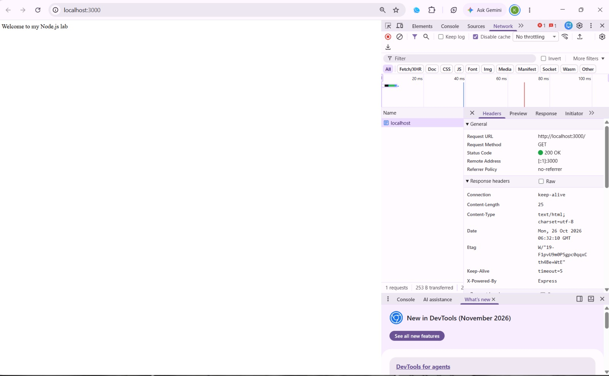
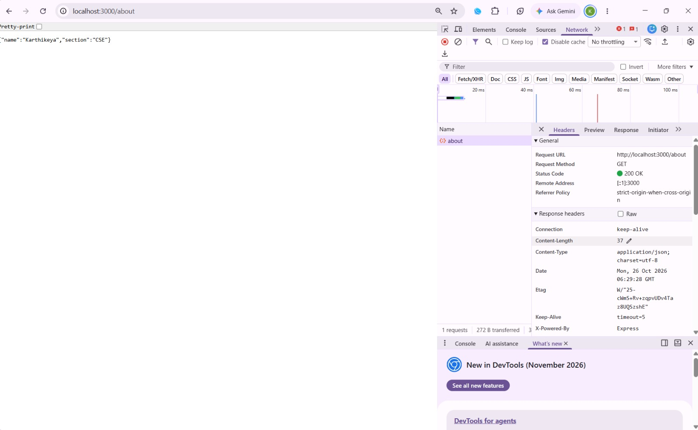
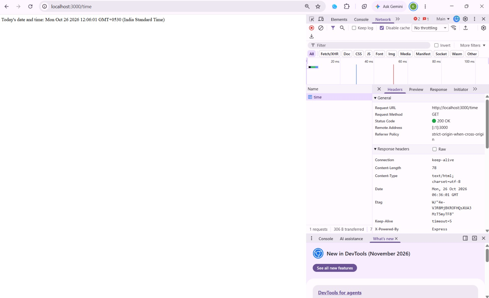
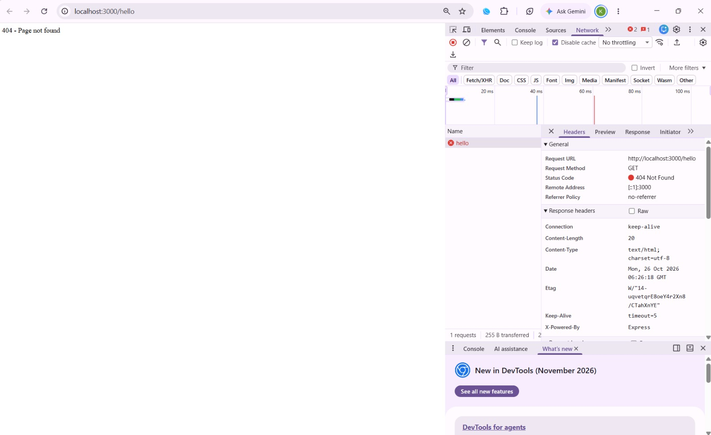

# Lab 2 - Node.js, Express.js and SQLite

**Name:** Anaganti Karthikeya  
**Registration Number:** 252U1R1012  
**Section:** CSE-2A  

---

## About

This lab is about building a **RESTful API** for a Library Book Management System using **Node.js**, **Express.js**, and **SQLite** as the database.

The API supports full **CRUD** (Create, Read, Update, Delete) operations on a `book` table.

---

## Tech Stack

- **Node.js** – Runtime environment
- **Express.js** – Web framework
- **SQLite** – Lightweight file-based database
- **sqlite3 & sqlite** – Node.js SQLite drivers

---

## API Endpoints

| Method | Endpoint | Description |
|--------|----------|-------------|
| GET | `/books/` | Get all books |
| GET | `/books/:bookId/` | Get a book by ID |
| POST | `/books/` | Add a new book |
| PUT | `/books/:bookId/` | Update a book by ID |
| DELETE | `/books/:bookId/` | Delete a book by ID |

---

## Database Schema

```sql
CREATE TABLE IF NOT EXISTS book (
  id     INTEGER PRIMARY KEY,
  title  TEXT,
  author TEXT,
  price  INTEGER,
  pages  INTEGER
);
```

---

## How to Run

### 1. Install dependencies

```bash
npm install
```

### 2. Seed the database (optional)

```bash
node addBooks.js
```

This inserts 10 sample books into the database.

### 3. Start the server

```bash
npm start
```

Or with auto-reload using nodemon:

```bash
npm run dev
```

The server will start on **http://localhost:3000**

---

## Sample API Usage

### Get all books
```
GET http://localhost:3000/books/
```

### Get book by ID
```
GET http://localhost:3000/books/1/
```

### Add a new book
```
POST http://localhost:3000/books/
Content-Type: application/json

{
  "title": "Atomic Habits",
  "author": "James Clear",
  "price": 450,
  "pages": 320
}
```

### Update a book
```
PUT http://localhost:3000/books/1/
Content-Type: application/json

{
  "title": "Updated Title",
  "author": "Updated Author",
  "price": 500,
  "pages": 400
}
```

### Delete a book
```
DELETE http://localhost:3000/books/1/
```
Lab 1 - Node.js and Express Server

Name: Anaganti Karthikeya

Registration Number: 252U1R1012

Section: CSE-2A

This lab is about creating a web server using Node.js and Express.js. First, I created a basic server using the HTTP module in Node.js. It responds with "Hello" when opened in the browser.

After that, I created another server using Express.js. The home page displays a welcome message. The about page displays my name and section in JSON format. The time page displays the current date and time. When an unknown page is opened, it displays a 404 Page not found message.

I tested the pages in the browser and checked their status codes using Developer Tools. The home, about and time pages returned 200 OK, while the unknown page returned 404 Not Found.

The project uses Node.js, Express.js and JavaScript. The source files are available in this repository.

## Live URL
https://node-express-lab1.onrender.com

## Screenshots








