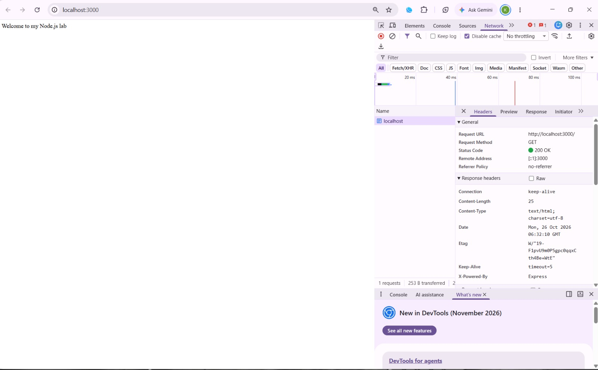
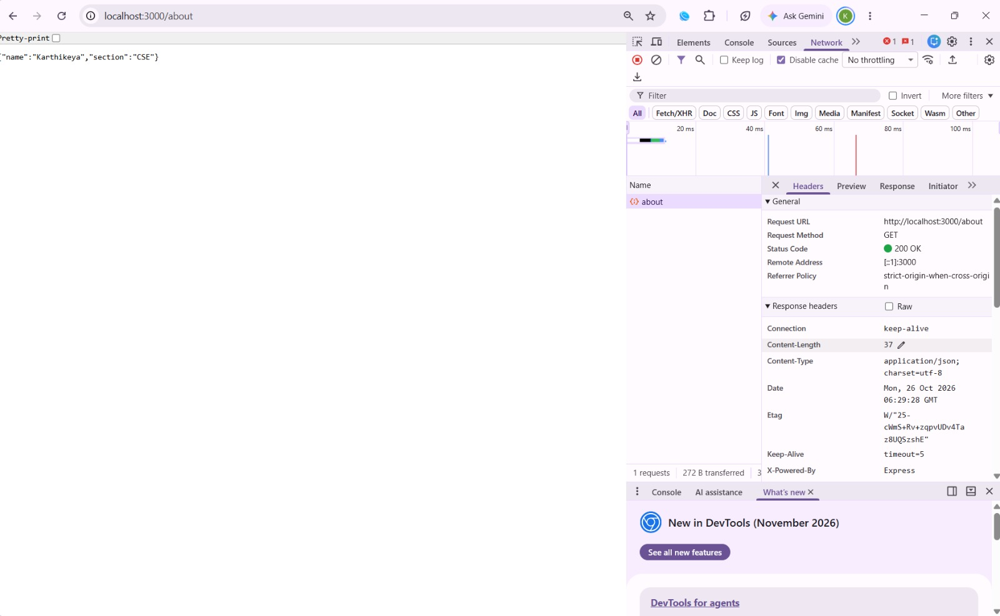
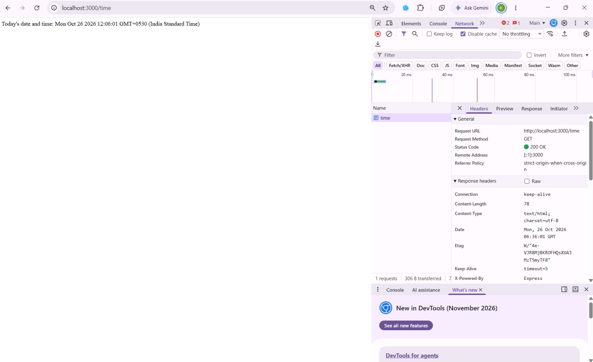
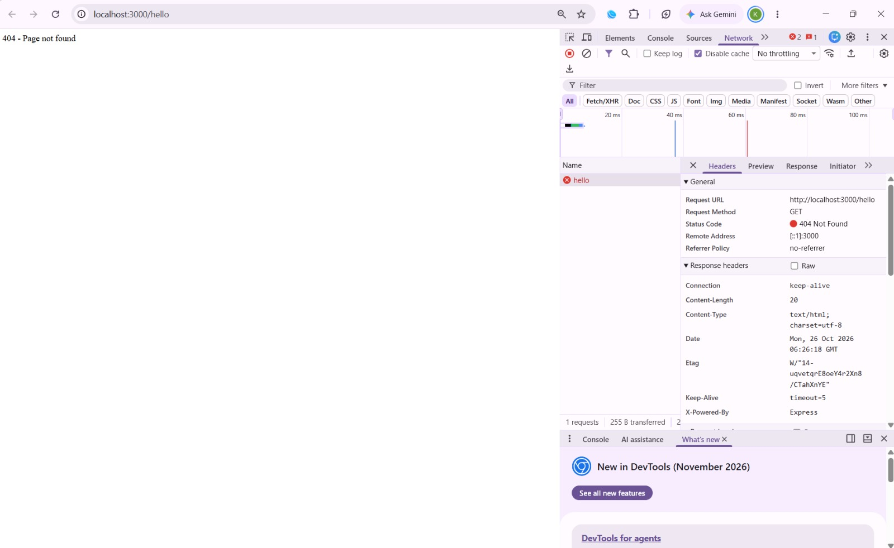

# Lab 1 - Node.js and Express Server

Name: Anaganti Karthikeya  
Roll No: 252U1R1012  
Section: CSE-2A

## Live URL
https://node-express-lab1.onrender.com

## About
In this lab, I created a Node.js server and used Express to handle different routes. I tested the pages in the browser, and all the routes worked as expected

## How to Run
Run `npm install` to install the required packages. Then run `npm start` to start the server. Open `http://localhost:3000` in your browser. To access it online, use the Live URL above.

## Routes
/ - Welcome message

/about - Name and section

/time - Current date and time

/hello - 404 page not found

## Screenshots

Home page shows the welcome message. The about page displays my name and section. The time page shows the current date and time. I also checked an invalid URL to see the 404 message.

All the pages were tested in the browser.

