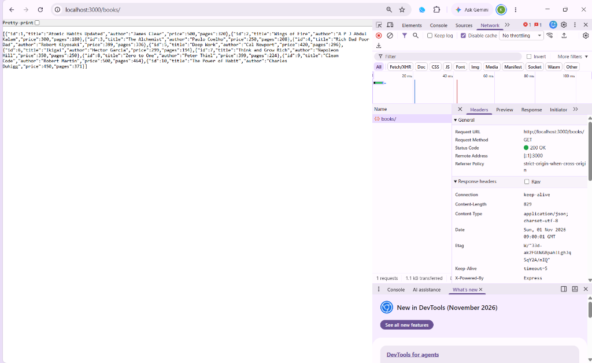
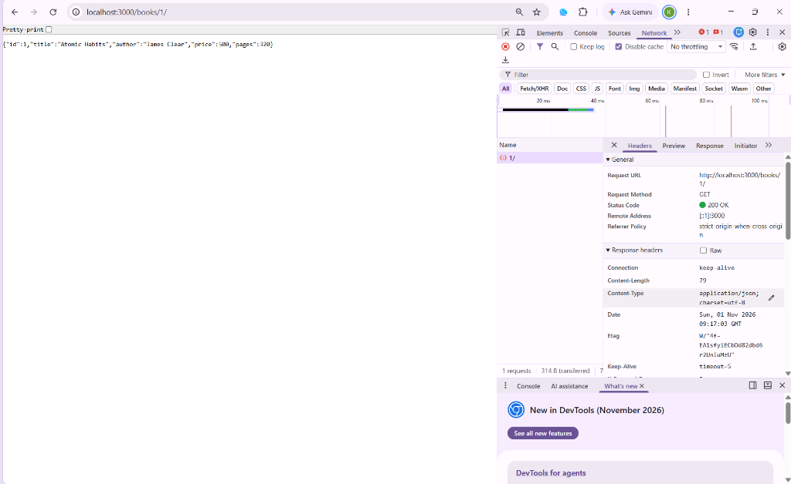
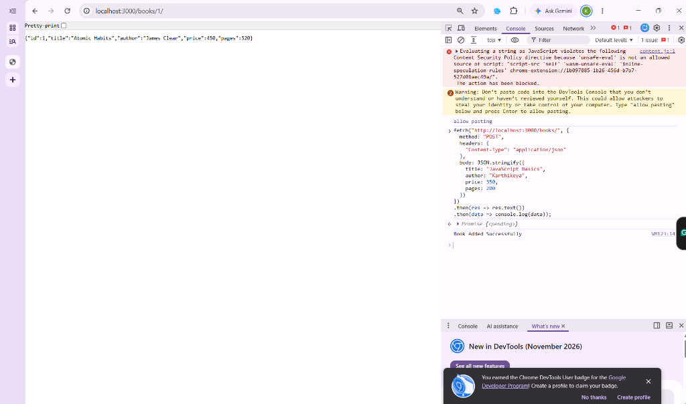
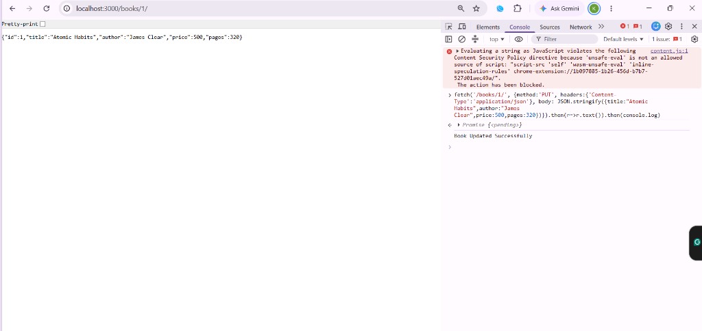
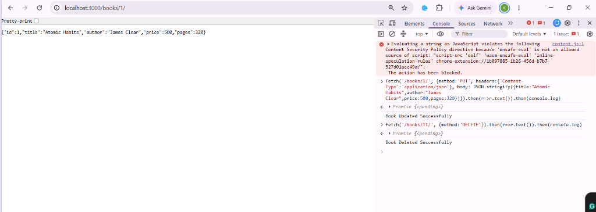

# Lab 2: SQLite database and CRUD routes

**Name:** Anaganti Karthikeya  
**Registration Number:** 252U1R1012  
**Section:** CSE-2A  

---

## Live Link

Not applicable – deployment requires a persistent file system for SQLite. Postman screenshots of all working endpoints are provided in the screenshots/ folder below.

---

## How to Run

### 1. Install dependencies

```bash
npm install
```

### 2. Seed the database (insert sample books)

```bash
node addBooks.js
```

### 3. Start the server

```bash
npm start
```

Or with auto-reload:

```bash
npm run dev
```

> Server runs at **http://localhost:3000**

> **Environment variables:** None required for this lab.

---

## Endpoints

| Method | Path | Description |
|--------|------|-------------|
| GET | `/books/` | Get all books from the database |
| GET | `/books/:bookId/` | Get a single book by its ID |
| POST | `/books/` | Add a new book |
| PUT | `/books/:bookId/` | Update an existing book by ID |
| DELETE | `/books/:bookId/` | Delete a book by ID |

---

## Screenshots

### GET /books/ — All books


### GET /books/:bookId/ — Single book


### POST /books/ — Add a book


### PUT /books/:bookId/ — Update a book


### DELETE /books/:bookId/ — Delete a book


---

## Notes: Problems Faced and How I Solved Them

- **Problem:** The SQLite database file was accidentally committed to git.  
  **Solution:** Added `*.db` to `.gitignore` and used `addBooks.js` as a seed script instead of committing the `.db` file.

- **Problem:** Used string concatenation in queries initially, which is unsafe (SQL injection risk).  
  **Solution:** Replaced all query strings with parameterised queries using `?` placeholders as required by the lab rules.
